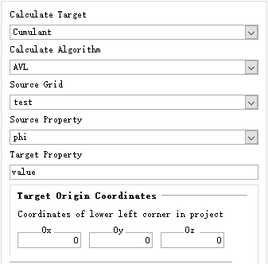
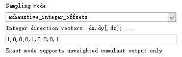
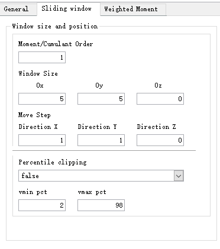
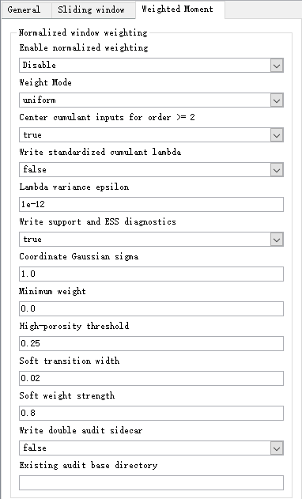

# Interface guide

These panels accompany the 2 November 2026 plugin package and Supplementary
Figs. S1-S4. The template illustrations retain the unchanged panel contents;
the two moving-window illustrations show the current interface. Screenshots
identify controls, while the [quick start](QUICKSTART.md) and shipped
`examples/*.par` files specify reproducible test settings.

## General settings

Select the statistic, evaluator, source grid/property, target property, and
output origin. Both plugins require a Cartesian source grid. Use a new target
property for each calculation. `Bell` and `AVL` select the unweighted
evaluators; enabling moving-window weighting uses the shared weighted
univariate recurrence.

## Exact Template settings

The illustrated exact mode uses `exhaustive_integer_offsets` and the Cartesian
integer direction vectors `(1,0,0)`, `(0,1,0)`, and `(0,0,1)`. Exhaustive
translations provide complete tuples. The accompanying occurrences, lag counts,
and lag separations in the template geometry controls define the requested
configuration; the origin contributes one occurrence. Three-dimensional inputs
use the exact mode. Its full settings are listed in the
[template example](QUICKSTART.md#5-repeat-an-exact-template-calculation).

Template calculations use equal contributions from complete tuples. Weighting
controls are provided by `HOSC_WINDOW`. The template output enumerates lag
combinations, whereas window outputs identify source-grid window centres.

## Sliding-window settings

Set the order, window dimensions, and move steps. The supplied image shows
illustrative interface values, including the legacy single-layer Z=`0` value;
use window size Z=`1` and step Z=`0` for an XY layer. For a three-dimensional
calculation, use a positive Z size and step. The shipped uniform example uses
order 4, size `3 / 3 / 3`, and step `1 / 1 / 1`.

The primary output retains the calculated statistic and its sign. Optional
percentile clipping creates an additional `<target>_clipped` display property;
the percentile fields apply when clipping is enabled. The primary property and
double-precision audit retain the original calculated values. The audit also
records numerical and display-validity flags.

## Weighting and optional outputs

With **Enable normalized weighting = Disable**, all retained samples have equal
influence. Enable weighting to use `uniform`, `coordinate_gaussian`, or
`soft_high_porosity`. Weights are normalized within each window and the same
normalized contributions enter all required moment orders.

| Control | Effect |
|---|---|
| Coordinate Gaussian sigma | Sets the distance-decay scale about the window centre in `coordinate_gaussian` mode |
| Minimum weight | Sets weights below this threshold to zero before normalization |
| High-porosity threshold, soft transition width, soft weight strength | Set the transition location, smoothness, and strength in `soft_high_porosity` mode |
| Center cumulant inputs for order >= 2 | Centres inputs for the cumulant computation at orders two and above |
| Write standardized cumulant lambda | Adds `lambda_r = kappa_r / kappa2^(r/2)` and its validity output |
| Lambda variance epsilon | Sets the variance threshold for standardized-output validity |
| Write support and ESS diagnostics | Adds retained support, effective sample size, and validity properties |
| Write double audit sidecar | Writes double-precision values and resolved settings beneath an existing writable directory |

Coordinate weights are centred on the geometric window centre. Normalization
is automatic; the legacy first-moment centring option and primary-output
inversion are inactive in the plugin. These fixed settings require no separate
interface selections. The remaining centring control shown above is a distinct
calculation option and remains available.

The screenshot shows weighting disabled and optional output selections that may
differ from the shipped examples. Load the relevant `.par` file or follow the
quick-start table for a reproducible run. See the
[numerical contract](NUMERICAL_CONTRACT.md) and
[parameter mapping](PARAMETER_MAPPING.md) for the complete definitions.
