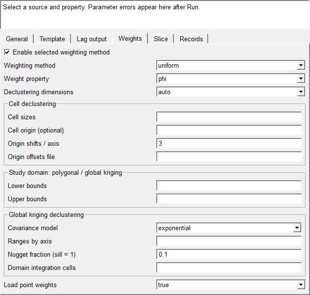
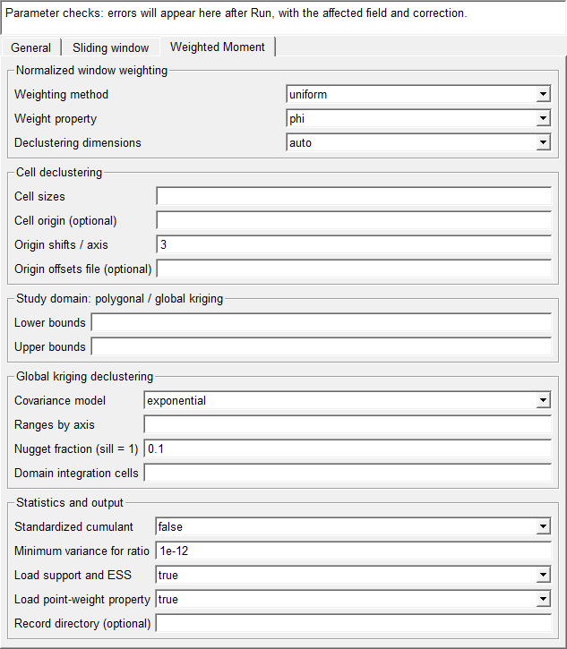

# Interface guide

Both modules appear under **Utilities** in SGeMS x64 Beta. **Source property** and **Weight property** follow the selected grid or point set.

## Template module

The six pages are **General**, **Template**, **Lag output**, **Weights**, **Slice** and **Records**. Select the input property, statistic and evaluator; define occurrences and lag geometry; then select the displayed lag directions. Output axes represent lag configurations, not the original model locations.

**Enable selected weighting method** controls whether the selected weighting source is applied. The five choices are uniform, cell declustering, polygonal declustering, global kriging declustering and external weights. External weights read the selected property and do not require declustering parameters.

## Moving-window module

The three pages are **General**, **Sliding window** and **Weighted Moment**. Regular-grid window sizes and steps are in cells. Point-set half-sizes/radii and center-grid spacing use input coordinate units. Point windows support box and ellipsoid neighborhoods, with sample-point centers or a regular output grid.

Bell selects the partition reference for templates and the univariate recurrence for moving windows; AVL selects the respective AVL-based evaluator. The Qt4 parameter adapter restores these selections when a saved `.par` is loaded. Check the visible selection before a comparison run; `performance.csv` also records the resolved algorithm.

Choose a persistent **Record directory** to keep full-precision results and performance records. Optional support, effective sample size and point-weight properties can also be loaded into SGeMS. See [performance definitions](PERFORMANCE.md).
